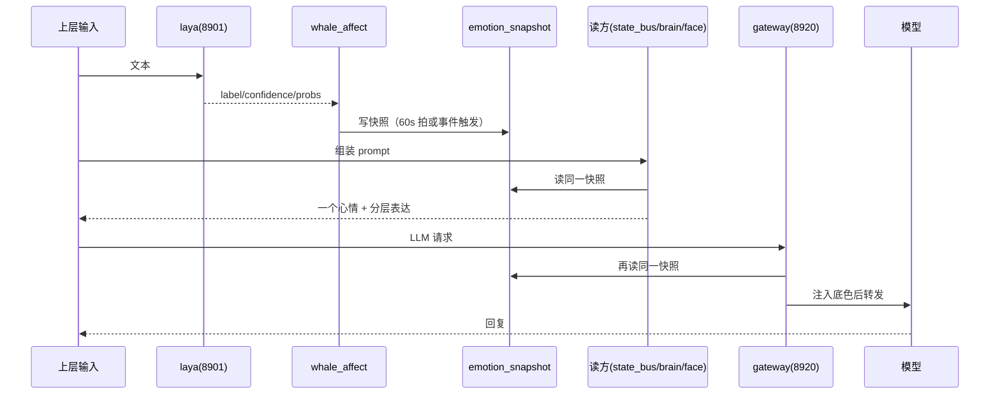

# 情绪闭环完整流程

## 1. 启动顺序

1. 启动 laya 分类器（8901），确认 `/health` 返回 8 类。
2. 启动 BEAM 网关（8920），确认 `/health` 的 `ok=true`。
3. 上层运行时加载 `emotion_core` 与 `whale_affect`。
4. `whale_affect.claim()` 成功，成为唯一写者。
5. 后台循环启动（60s 一拍），开始写 `emotion_snapshot.json`。
6. 各读方按 `shadow_switches.json` 选择 `snapshot` 或 `legacy`。

## 2. 每一拍（tick）做什么

```
每 60s：
  读取身体（能量/内感受） + 事件 + 分类器结果
    → 计算 valence/arousal/label/intensity
    → moodfusion 合成底色/温度/表达
    → hub.update()（只有写者能写）
    → 原子写 emotion_snapshot.json
    → 影子日志 [emotion-shadow]
```

## 3. 一条消息进来时



## 4. 读方与开关

`emotion_core/shadow_switches.json`：

| 键 | 值 | 含义 |
|---|---|---|
| `emotion.snapshot` | `shadow` / `on` / `off` | 是否写快照 |
| `emotion.reader.state_bus` | `snapshot` / `legacy` | 状态块读哪 |
| `emotion.reader.brain` | `snapshot` / `legacy` | `<psyche>` 读哪 |
| `emotion.reader.face` | `snapshot` / `legacy` | 表情/语气读哪 |
| `emotion.reader.meme` | `snapshot` / `legacy` | 表情出口 |
| `emotion.reader.urge` | `snapshot` / `legacy` | 欲望 |
| `emotion.reader.bili` | `snapshot` / `legacy` | 内容出口 |
| `emotion.reader.voice` | `snapshot` / `legacy` | 开口闸门 |
| `voice.want_source` | `broker` / `legacy` | want 口径 |

**回滚**：把对应值改回 `legacy/off`，5 秒热读生效，不用重启。

## 5. 分层情绪（moodfusion）

不是只有一个标签：

- **底色**：主情绪（如"黏人"）
- **温度**：强度/唤醒
- **表达**：尾巴、语气、颜文字、口癖
- **扰动**：事件带来的短期偏移

读方看到的是同一份底色，但表达可以不同；这样既统一又不扁平。

## 6. 开口闸门（expression gate）

输入：want、threshold、reason、额度、状态。
输出：

```json
{
  "want": 0.316,
  "threshold": 0.70,
  "decision": "deny",
  "code": "low_want",
  "explain": "想说程度 0.32 还没过 0.70，再等等。",
  "want_source": "broker"
}
```

**硬规则**：`want` 只能用 broker 值；不能再被别的分数覆盖，否则 explain 与 decision 会打架。

## 7. 失败与降级

| 失败 | 表现 | 处理 |
|---|---|---|
| 8901 不在 | 分类器超时 | 回退词表/neutral，不阻塞 |
| 8920 不在 | 回复连接失败 | 网关重启后重连；上层提示 |
| 快照不写 | `emotion_snapshot.json` 不更新 | 检查写者 claim 与主循环 |
| 快照过期 | 读方回退 legacy | `stale_after`（默认 300s） |
| 多心情 | prompt 出现两个词 | 查 reader/网关是否都读 snapshot |
| 闸门矛盾 | want>threshold 却 deny | 查 `want_source` 与覆盖逻辑 |

## 8. 验收流程（可复现）

1. `/health`：8901 返回 8 类；8920 `ok=true`。
2. 快照：`emotion_snapshot.json` 在 60s 内更新，`mood` 非空。
3. 写者：日志有 `情绪写者已登记` 与 `主循环已启动`。
4. 读方：`[emotion-shadow]` 各 reader 的 mood 一致。
5. 网关：`requests == injected`。
6. 闸门：`want/threshold/decision/explain` 同口径。
7. 真消息：一轮 prompt 只出现一个心情。

## 9. 已知边界

- 快照写入依赖 `whale_affect` 主循环；只热重载不重启可能空转。
- 部分读方（如主动消息）尚未完全切到快照。
- 分类器是"输入特征"，不是情绪事实源；最终事实仍由 `whale_affect` 写。